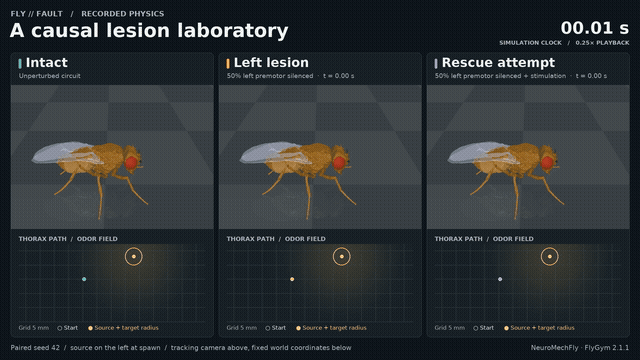
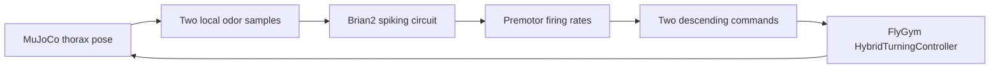

# FLY//FAULT

**A causal lesion laboratory for an embodied virtual fly**

A 100-neuron Brian2 spiking circuit drives a biomechanical NeuroMechFly in MuJoCo. Targeted lesions change its physical navigation, and sensory-driven stimulation attempts to recover behavior.



[Full 1080p comparison](examples/demo/media/flyfault_comparison.mp4) · [Perturbation atlas](examples/demo/figures/perturbation_atlas.png) · [Methods](docs/methods.md) · [Measured results](docs/results.md)

## The experiment

The fly navigates a flat arena toward a laterally offset Gaussian odor source. Two virtual antennae attached to the thorax sample the local field. Those readings drive the spiking circuit, whose premotor activity determines two descending leg-drive signals. FlyGym's official hybrid turning controller converts them into joint and adhesion actuation, and MuJoCo integrates the resulting motion.



The circuit is hand-designed, connectome-inspired and phenomenological. Its online inputs are the two local concentrations. The environment and evaluation code use source location and pose to generate sensory measurements and score behavior. Physics runs at 0.1 ms, the neural integration at 0.5 ms, and descending commands update every 20 ms from the preceding neural window.

The paired pilot includes six conditions, two independent seeds, and both source sides, with a 2 s timeout.

| Condition | Reached source | Mean distance improvement |
| --- | ---: | ---: |
| Intact | 0/4 | +12.26 mm |
| Left premotor lesion | 0/4 | −7.16 mm |
| Right premotor lesion | 0/4 | −7.48 mm |
| Size-matched random sham | 0/4 | +12.25 mm |
| Left lesion + rescue attempt | 2/4 | +14.70 mm |
| Constant descending drive | 0/4 | +9.35 mm |

Positive improvement means the fly ended closer to the source. The lesion conditions produced opposite turn biases. Rescue improved progress relative to the paired left lesion by 21.59 and 22.14 mm for the two seeds, averaging source sides within each seed. Both arrivals were on right-source trials. There were no flips or arena exits. Two seeds support descriptive pilot comparisons. The eight-seed benchmark remains to be run. [Full results and limitations](docs/results.md)


## Try the recorded experiment

The repository includes [all 24 numeric trial records](examples/README.md), reviewed manifests, representative video, and PNG/SVG figures. The dashboard reads these saved artifacts.

Use native ARM64 macOS with Homebrew and `uv`.

```bash
git clone https://github.com/ai1144/flyfault.git
cd flyfault
brew install uv
sh scripts/bootstrap.sh
.venv/bin/python -m flyfault dashboard --results examples/demo
```

Open the local URL printed by Streamlit, normally `http://127.0.0.1:8501`. Select a condition, seed and source side to inspect physical outcomes, spikes, odor readings, stimulation, and motor commands. The comparison replay uses the first configured seed and the left source. All three displayed episodes time out.

The checked setup uses CPython 3.12.13, FlyGym 2.1.1, MuJoCo 3.16.0, Brian2 2.9.0, and NumPy 2.2.6. `uv.lock` pins the full environment. The NumPy pin resolves the Brian2 import failure observed with NumPy 2.4 and 2.5.

## Run a new experiment

```bash
# Short physical fly + SNN smoke test
sh scripts/smoke.sh

# One episode
.venv/bin/python -m flyfault run --config configs/demo.yaml --condition intact --seed 42 --stimulus-side right

# Paired 24-trial pilot
sh scripts/run_demo.sh

# Substitute the run directory printed by the command above
sh scripts/render.sh --run-dir results/RUN_ID
.venv/bin/python -m flyfault dashboard --results results
```

Each local run stores a manifest, numeric signals, summary, FlyGym trajectory, and compatible compiled MuJoCo model. Repeating a batch command reuses completed episodes. Rendering reads saved trajectories. The full eight-seed protocol is available through `sh scripts/run_benchmark.sh` and creates 96 episodes with approximately 2 GB of compiled models.

```bash
# Validate native imports, assets and an offscreen render
sh scripts/doctor.sh

# Rebuild the included plots without rerunning physics
.venv/bin/python -m flyfault render --run-dir examples/demo --plots-only

.venv/bin/ruff check .
.venv/bin/pytest -q
```

The original verification passed 20 tests and audited 260,333 recorded spikes. The 1080p H.264 comparison decoded 201 frames at 25 fps. See [the execution record](docs/results.md) and [reproducibility details](docs/reproducibility.md).

## Platform notes and data

- Native macOS CGL rendering needs a logged-in desktop graphics session. For an invalid CoreGraphics connection, run the renderer from Terminal in that session. `doctor --skip-gl` checks the environment without OpenGL.
- MuJoCo installs `.venv/bin/mjpython`, which is the required launcher for macOS scripts using its passive viewer. The provided replay workflow uses ordinary Python.
- The simplified NeuroMechFly meshes and gait templates are bundled with FlyGym. A composition using full-resolution meshes may download additional simulator assets.
- The published example retains the measured scientific arrays and configuration. Personal filesystem paths, interpreter locations, shell commands, and execution timestamps were removed from its manifests. Virtual environments, credentials, caches, full physics archives, and raw execution logs are excluded from version control.

## Credits and license

FLY//FAULT code is released under the [MIT license](LICENSE). Dependencies and simulator assets retain their own licenses. Please cite the underlying simulators when using this project.

[NeuroMechFly citation](https://neuromechfly.org/2.1.1/citation/) · [FlyGym 2.1.1](https://github.com/NeLy-EPFL/flygym/tree/v2.1.1) · [MuJoCo](https://mujoco.readthedocs.io/en/stable/python.html) · [Brian2 2.9.0](https://brian2.readthedocs.io/en/2.9.0/)
