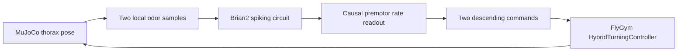

# FLY//FAULT

**A causal lesion laboratory for an embodied virtual fly**


[Watch the local preview](media/preview.gif) · [Methods](docs/methods.md) · [Reproducibility](docs/reproducibility.md)

How does silencing part of a spiking sensorimotor circuit change navigation in a biomechanically simulated fly? Can a current driven by local odor samples recover some of that behavior? FLY//FAULT couples a 100-neuron Brian2 circuit to the official FlyGym 2.1.1 turning controller. MuJoCo integrates the resulting joint and adhesion commands on CPU.



The hand-designed circuit is connectome-inspired and phenomenological. Two thorax-fixed virtual antennae sample a smooth planar Gaussian field. The controller receives local concentration only. Pose, target location, and heading error are available to the environment and evaluation code. The six study conditions are intact, left lesion, right lesion, size-matched random reserve lesion, attempted sensory-driven rescue, and constant descending drive. The latter retains the lower-level gait controller.

## Run on Apple Silicon

Use native ARM64 macOS. The checked lock uses CPython 3.12, FlyGym 2.1.1, MuJoCo 3.16.0, Brian2 2.9.0 and NumPy 2.2.6. The NumPy pin is required for Brian2 import on this setup. The project uses the standard CPU FlyGym install.

```bash
# If uv is missing and this folder has no .tooling/bin/uv
brew install uv

./scripts/bootstrap.sh
./scripts/smoke.sh
```

`bootstrap.sh` uses a project-local managed Python installation, runs `uv sync --locked`, and checks imports and native architectures. `.venv/bin/python` is the entry point for experiments, analysis, replay, and the dashboard. From the logged-in macOS desktop, run `./scripts/doctor.sh` to additionally verify a real offscreen render.

```bash
.venv/bin/python -m flyfault run --config configs/demo.yaml --condition intact --seed 42 --stimulus-side right
./scripts/run_demo.sh
./scripts/render.sh --run-dir results/REPLACE_WITH_PRINTED_RUN_ID
.venv/bin/python -m flyfault dashboard --results results
.venv/bin/ruff check .
.venv/bin/pytest -q
```

Open the loopback URL printed by the dashboard, normally `http://127.0.0.1:8501`. It reads saved data and supports run, seed, side, and condition selection. The demo runs two paired seeds × two stimulus sides × six arms for a maximum of 2 s per episode. Run `./scripts/run_benchmark.sh` explicitly for the eight-seed protocol. It creates 96 episode directories and writes about 2 GB of compiled model files. Repeat the same batch command to resume completed episodes.

## Recorded study

See [the executed study and verification record](docs/results.md) for measured outcomes, raw artifact locations, and commands. Replay composition uses the first configured seed and stimulus side. The atlas includes every demo trial. Each episode has a manifest, raw spiking and kinematic arrays, a JSON summary, a saved FlyGym trajectory, and the compatible compiled MuJoCo model. Plots can be rebuilt from saved data with `render --plots-only`.

## Troubleshooting and credits

- Native macOS CGL needs a logged-in graphics session. If it reports an invalid CoreGraphics connection, retry the render from Terminal in the desktop session. `doctor --skip-gl` checks the environment without OpenGL. The real replay test needs CGL.
- `.venv/bin/mjpython` is installed by MuJoCo and is the required launcher for scripts that use the macOS passive viewer. The supplied replay workflow uses ordinary Python and renders from saved trajectories.
- The bundled simplified NeuroMechFly meshes and locomotion templates were sufficient on this machine. Model hashes are recorded per episode. A composition using full-resolution meshes can trigger FlyGym asset downloads.
- FLY//FAULT code is MIT-licensed. Dependencies and bundled simulator assets are used under their own licenses. See [NeuroMechFly credits and citation](https://neuromechfly.org/2.1.1/citation/), [FlyGym 2.1.1](https://github.com/NeLy-EPFL/flygym/tree/v2.1.1), [MuJoCo documentation](https://mujoco.readthedocs.io/en/stable/python.html), and [Brian2 documentation](https://brian2.readthedocs.io/en/2.9.0/).
